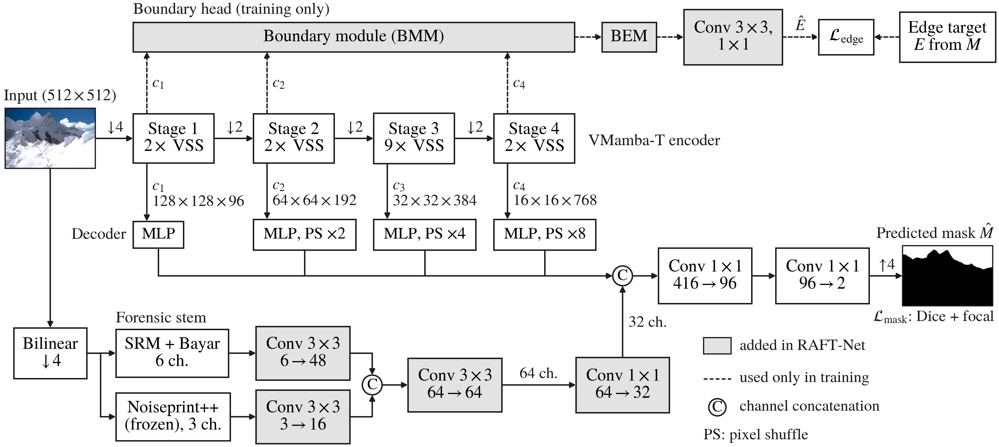

# RAFT-Net: Boundary-Aware Forensic Fusion for Generalizable Mamba-Based Image Forgery Localization

Source code for the manuscript *RAFT-Net: Boundary-Aware Forensic Fusion for Generalizable Mamba-Based Image Forgery
Localization*, submitted to IEEE Access (2026), by B. V. Satish Babu, Pachappagari Naveen Kumar, Chakali Pavan Kumar,
Thatte Mohan and Kammari Jaya Prakash (School of Computer Science and Engineering, VIT-AP University, Amaravati, India).
Corresponding author: B. V. Satish Babu (satishbabu.bv@vitap.ac.in).

RAFT-Net (Residual-Aware Fusion with Tamper-boundary supervision) builds on [ForMa](https://github.com/multimediaFor/ForMa).
It keeps ForMa's VMamba-tiny encoder and pixel-shuffle decoder, passes 32 channels of noise features (SRM, Bayar,
Noiseprint++) to the decoder instead of ForMa's three-channel mixture, and adds a boundary head that learns the edges of
tampered regions and is used only in training. All models are trained on CASIA v2 only (Protocol 1) and tested on
CASIA v1, Columbia and IMD2020; most configurations were trained three times, with seeds 1221, 1222 and 1223.



## Results

Per-image F1 (%), mean ± std over seeds 1221, 1222 and 1223. The average is weighted by the number of tampered
test images (920, 180 and 2,010).

| Method | CASIA v1 | Columbia | IMD2020 | Weighted avg. |
|---|---|---|---|---|
| ForMa (reproduced under our protocol) | 67.8 ± 1.0 | 68.2 ± 4.2 | 33.2 ± 1.8 | 45.5 ± 1.3 |
| **RAFT-Net** | **71.4 ± 1.0** | **83.2 ± 2.1** | 36.5 ± 1.6 | **49.5 ± 1.3** |
| MPC (best published Protocol 1 average) | 44.8 | 67.6 | 48.5 | 48.5 |

On CASIA v2 validation, RAFT-Net reaches 81.0 ± 0.2 F1 on clean images and stays 1.6 to 3.3 points ahead of ForMa
after JPEG recompression (quality 90 to 30) and a social-network-style processing chain. The paper reports the paired
tests, the ablation of every component and the analysis of the components we removed.

## Where each result of the paper comes from

| Paper | Notebook |
|---|---|
| All trained models: RAFT-Net, ForMa, the ablations and the widened ForMa | `notebooks/01_train.ipynb` |
| Comparison with published methods (Section V-A), paired comparison with ForMa (V-B), ablation study (V-C), robustness to compression (V-D), saliency check (V-G) | `notebooks/02_evaluate.ipynb` |
| Model size and speed (V-E), qualitative examples (V-F) | `notebooks/03_demo.ipynb` |

## Repository layout

```
notebooks/01_train.ipynb      training (one or two jobs per session, T4 x2)
notebooks/02_evaluate.ipynb   evaluation of every trained model, all result tables of the paper
notebooks/03_demo.ipynb       predictions on single images, showcase figures, speed benchmark
raftnet/raftnet.py            RAFT-Net model and all variants (imports ForMa's modules)
raftnet/common.py             data pipeline, augmentation, losses, schedule
raftnet/train_job.py          training loop with resumable checkpoints
raftnet/metrics_engine.py     per-image F1 / IoU / AUC
raftnet/datasets.py           discovery of the test datasets
assets/                       architecture figure (PNG and vector PDF)
```

The notebooks are self-contained: they clone ForMa, install `mamba-ssm` and `causal-conv1d`, apply small
compatibility patches to ForMa's code, write the files from `raftnet/` into ForMa's `models/` folder and run from
there. The copies in `raftnet/` are provided for reading and reuse.

## Requirements

Each training run uses one NVIDIA T4 GPU. We ran everything on Kaggle with the *GPU T4 x2* accelerator, which lets the
training notebook run two jobs side by side, and with Internet access enabled. The notebooks install what Kaggle does
not provide. To run elsewhere you need a CUDA GPU and the packages in `requirements.txt`, plus:

* ForMa: `git clone https://github.com/multimediaFor/ForMa.git` (the Noiseprint++ weights come with it);
* the ImageNet-pretrained VMamba-tiny checkpoint `vssm1_tiny_0230s_ckpt_epoch_264.pth` from the
  [VMamba releases](https://github.com/MzeroMiko/VMamba/releases); the training notebook downloads it.

## Data

| Dataset | Use | Images | Tampered images scored |
|---|---|---|---|
| CASIA v2 | training (11,225) and validation (1,247), fixed split with seed 1221 | 12,472 | 497 (validation) |
| CASIA v1 | test | 1,720 | 920 |
| Columbia | test | 363 | 180 |
| IMD2020 | test | 2,424 | 2,010 |

Attach the datasets as notebook inputs. The notebooks search the attached inputs, pair every tampered image with its
mask and print what they found, so the folder names do not have to follow a fixed layout. The datasets are not
included here; please obtain them from their original sources and respect their licences.

## Training

Open `notebooks/01_train.ipynb`, attach CASIA v2, choose *GPU T4 x2* and set the jobs in section 5:

```python
JOBS = [dict(job='raftnet_lite_nofullres_s1221', variant='raftnet_lite_nofullres', seed=1221, acr=0),
        dict(job='raftnet_lite_nofullres_s1222', variant='raftnet_lite_nofullres', seed=1222, acr=0)]
```

A job trains for 40 epochs (about 12 hours on one T4). If a Kaggle session ends first, run the notebook again with
its previous output attached and the job resumes from its last checkpoint. Each run keeps the checkpoint with the best
per-image F1 on CASIA v2 validation.

| `variant` | `acr` | Model in the paper |
|---|---|---|
| `raftnet_lite_nofullres` | 0 | **RAFT-Net (final)** |
| `raftnet_no_fcss` | 0 | RAFT-Net with full-resolution residuals |
| `raftnet` | 1 | original design (full-resolution residuals, FCSS, ACR) |
| `raftnet` | 0 | original design without ACR |
| `raftnet_no_fcss` / `raftnet_no_boundary` / `raftnet_no_fullres` | 1 | original design without one component |
| `forma` | 0 | ForMa baseline, retrained under the same protocol |
| `forma_w12` / `forma_w48` | 0 | ForMa with its forensic mixer widened to 12 / 48 channels |

## Evaluation

Open `notebooks/02_evaluate.ipynb` and attach the datasets and the training notebooks whose checkpoints you want to
score (plus the evaluator's own previous output, so finished models are not scored again). It produces the Protocol 1
table, the robustness table, the paired bootstrap tests, the ablations and the saliency check.

## Demo

`notebooks/03_demo.ipynb` loads one trained model (default `raftnet_lite_nofullres_s1223`), segments a chosen image,
draws best, typical and worst examples from each test set, shows the effect of recompression, runs the model on your
own images and measures parameters, latency and GPU memory.

## Checkpoints

Trained checkpoints are not included because of their size (about 150 MB each).

## Citation

The paper is under review at IEEE Access. Until it is published, please cite:

```bibtex
@misc{babu2026raftnet,
  title  = {{RAFT-Net}: Boundary-Aware Forensic Fusion for Generalizable Mamba-Based Image Forgery Localization},
  author = {Babu, B. V. Satish and Kumar, Pachappagari Naveen and Kumar, Chakali Pavan and Mohan, Thatte and Prakash, Kammari Jaya},
  year   = {2026},
  note   = {Manuscript submitted to IEEE Access. Code: https://github.com/naveenk2608/RAFT-Net}
}
```

## Acknowledgements and licences

This work builds on ForMa (Guo et al., IEEE Signal Processing Letters 2025), VMamba (Liu et al., NeurIPS 2024) and the
Noiseprint++ extractor of TruFor (Guillaro et al., CVPR 2023). Their code and weights are **not** redistributed here:
the notebooks download them from the original repositories, and their own licences and terms of use apply. Our own
code in this repository is released under the MIT licence (see `LICENSE`).

Parts of the code in this repository were written with the help of an AI assistant (Claude, Anthropic). All
experiments were run and all reported numbers were checked by the authors.
